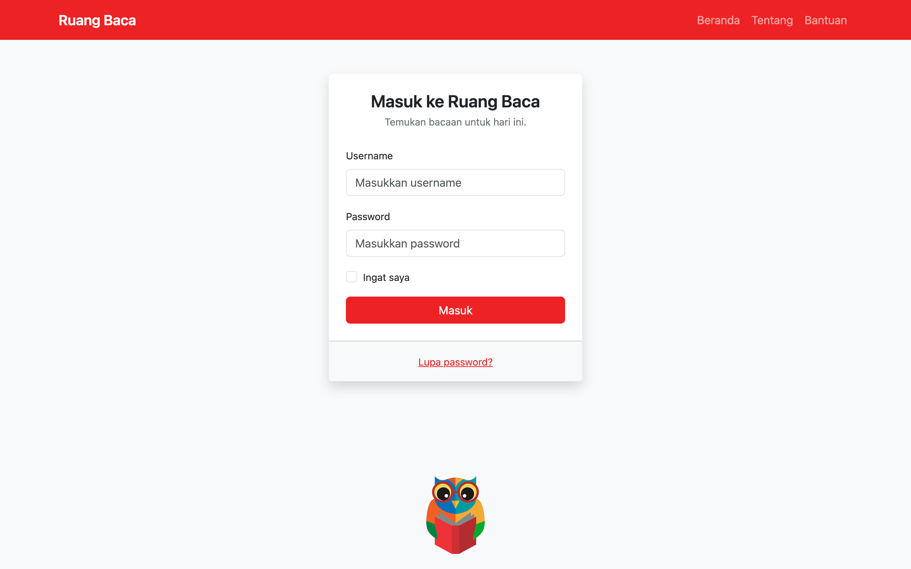
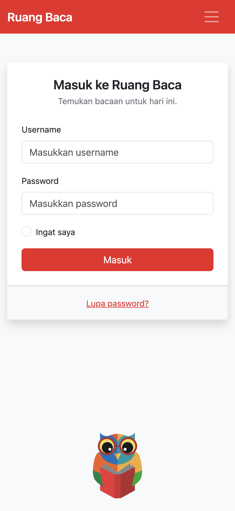

# Tugas Pendahuluan Modul 5 - Bootstrap

**Pemrograman Web - Ganjil 2026/2027**

| | |
|---|---|
| Nama | Ilham Fadilah |
| NIM | 103092400051 |
| Kelas | IT0701 |

---

## 1. Pengertian Bootstrap

**Bootstrap** adalah framework front-end open source yang berisi kumpulan CSS, JavaScript, komponen antarmuka, dan *utility class* siap pakai untuk membangun tampilan website yang responsif dengan pendekatan *mobile-first*. Bootstrap pertama kali dikembangkan oleh tim Twitter, dan pada tugas ini digunakan Bootstrap versi **5.3.8**.

**Kegunaan Bootstrap:**

- **Mempercepat pembuatan tampilan.** Komponen seperti navbar, card, form, dan tombol dapat dipakai langsung lewat class, tanpa menulis CSS dari nol. Pada tugas ini, navbar Ruang Baca, card login, dan tombol Masuk dibuat dengan komponen `navbar`, `card`, dan `btn`.
- **Membuat tampilan responsif.** Sistem grid 12 kolom dan breakpoint membuat satu halaman HTML dapat menyesuaikan diri dari layar ponsel hingga desktop.
- **Mengatur gaya dengan utility class.** Warna, jarak, lebar, tipografi, dan bayangan diatur langsung di HTML, misalnya `p-4`, `mb-3`, `text-center`, dan `shadow`.
- **Tampilan konsisten di berbagai browser.** Bootstrap menyertakan *reboot* (normalisasi gaya dasar) sehingga hasil tampilan seragam di berbagai browser.
- **Mudah dikustomisasi.** Warna dan gaya komponen dapat diubah lewat CSS variable. Pada tugas ini, warna tombol diubah melalui variabel `--bs-btn-bg` dan tema warna merah diatur melalui variabel `--rb-red`.
- **Komponen interaktif tanpa menulis JavaScript sendiri.** Menu navbar yang bisa dibuka-tutup pada layar kecil berjalan melalui atribut `data-bs-toggle="collapse"` dan berkas `bootstrap.bundle.min.js`.

---

## 2. Memasang Bootstrap

Terdapat empat cara untuk mengimpor atau menggunakan Bootstrap pada sebuah project:

**a. CDN (Content Delivery Network).** Berkas Bootstrap dimuat langsung dari server CDN sehingga tidak perlu mengunduh apa pun, tetapi memerlukan koneksi internet. Cara inilah yang dipakai pada `index.html` tugas ini:

```html
<!-- di dalam <head> -->
<link
  href="https://cdn.jsdelivr.net/npm/bootstrap@5.3.8/dist/css/bootstrap.min.css"
  rel="stylesheet"
/>

<!-- sebelum </body> -->
<script src="https://cdn.jsdelivr.net/npm/bootstrap@5.3.8/dist/js/bootstrap.bundle.min.js"></script>
```

**b. Mengunduh berkas compiled (CSS dan JS).** Unduh paket Bootstrap dari situs resmi getbootstrap.com, simpan pada folder project, lalu hubungkan dengan path relatif. Cara ini dapat dipakai tanpa internet (offline):

```html
<link href="css/bootstrap.min.css" rel="stylesheet" />
<script src="js/bootstrap.bundle.min.js"></script>
```

**c. Package manager.** Bootstrap dipasang melalui npm, yarn, atau Composer, lalu diimpor pada project yang memakai *bundler* seperti Vite atau webpack:

```bash
npm install bootstrap@5.3.8
```

```js
// pada berkas JavaScript project
import 'bootstrap/dist/css/bootstrap.min.css';
import 'bootstrap';
```

**d. Source Sass.** Berkas Sass sumber Bootstrap diimpor ke berkas Sass milik sendiri, lalu dikompilasi. Cara ini dipilih bila ingin mengubah variabel dan komponen Bootstrap secara mendalam sebelum dikompilasi.

> **Catatan:** `bootstrap.bundle.min.js` sudah menyertakan Popper, sedangkan `bootstrap.min.js` tidak. Selain itu, tag `<meta name="viewport" content="width=device-width, initial-scale=1">` wajib ada di `<head>` agar tampilan responsif bekerja di perangkat seluler.

---

## 3. Grid dan Breakpoint

**Grid** pada Bootstrap adalah sistem tata letak berbasis *flexbox* dengan **12 kolom** pada setiap baris. Susunannya berjenjang: `container` membungkus `row`, dan `row` membungkus beberapa `col`.

**Class grid yang utama:**

| Class | Kegunaan |
|---|---|
| `.container`, `.container-fluid`, `.container-{breakpoint}` | Pembungkus konten. `container` memiliki lebar maksimum yang berubah per breakpoint, sedangkan `container-fluid` selalu selebar layar (100%). |
| `.row` | Baris yang membungkus kolom. Menggunakan flexbox dan mengatur jarak antarkolom (gutter). |
| `.col`, `.col-{n}`, `.col-{breakpoint}-{n}` | Menentukan lebar kolom sebanyak n dari 12 bagian. `.col` tanpa angka membagi lebar sama rata, `.col-auto` mengikuti lebar isinya. |
| `.g-*`, `.gx-*`, `.gy-*` | Mengatur gutter (jarak antarkolom) secara keseluruhan, horizontal, atau vertikal. |
| `.offset-{breakpoint}-{n}` | Menggeser kolom ke kanan sebanyak n kolom. |
| `.justify-content-*`, `.align-items-*` | Mengatur perataan kolom secara horizontal dan vertikal di dalam row. |

**Breakpoint pada Bootstrap 5.3:**

| Breakpoint | Class infix | Lebar layar | Perangkat umum |
|---|---|---|---|
| Extra small | (tanpa infix) | < 576px | Ponsel (potret) |
| Small | `sm` | ≥ 576px | Ponsel (lanskap) |
| Medium | `md` | ≥ 768px | Tablet |
| Large | `lg` | ≥ 992px | Laptop / desktop kecil |
| Extra large | `xl` | ≥ 1200px | Desktop |
| Extra extra large | `xxl` | ≥ 1400px | Desktop layar lebar |

**Kegunaan breakpoint:**

Breakpoint adalah batas lebar layar tempat tata letak berubah. Bootstrap menerapkannya dengan media query `min-width` sehingga bersifat *mobile-first*: class tanpa breakpoint berlaku untuk semua ukuran layar, sedangkan class ber-breakpoint (misalnya `col-md-8`) berlaku mulai ukuran tersebut ke atas. Dengan begitu satu kode HTML dapat tampil optimal di ponsel, tablet, maupun desktop, dan breakpoint juga menentukan kapan komponen seperti navbar berubah bentuk.

**Penerapan pada `index.html`:**

- Form login dibungkus `<div class="col-12 col-sm-10 col-md-8 col-lg-6 col-xl-4">` di dalam `<div class="row justify-content-center">`. Lebar form adalah 12/12 kolom di bawah 576px (penuh di ponsel), 10/12 pada `sm`, 8/12 pada `md`, 6/12 pada `lg`, dan 4/12 pada `xl` ke atas, sehingga form tetap terbaca di layar kecil dan tidak terlalu lebar di layar besar.
- Navbar memakai `navbar-expand-md`: menu Beranda, Tentang, dan Bantuan terbentang di kanan pada layar ≥ 768px, dan berubah menjadi ikon hamburger pada layar yang lebih kecil.

---

## 4. Class Bootstrap

Berikut class yang disediakan Bootstrap beserta kegunaan dan contoh penggunaannya pada `index.html`:

| Class | Kegunaan | Contoh pada tugas |
|---|---|---|
| `container` | Membungkus konten dan memusatkannya dengan lebar maksimum yang responsif. | `<main class="container py-5">` |
| `row` dan `col-*` | Membentuk tata letak grid 12 kolom yang responsif. | `row justify-content-center`, `col-12 col-sm-10 col-md-8 col-lg-6 col-xl-4` |
| `navbar`, `navbar-expand-md`, `navbar-dark` | Membuat bar navigasi yang menyesuaikan layar; `navbar-dark` membuat teks menjadi terang. | `<nav class="navbar navbar-expand-md navbar-dark bg-ruang">` |
| `card`, `card-body`, `card-footer` | Komponen kotak untuk mengelompokkan konten beserta bagian isi dan kaki. | `card border-0 shadow` berisi form dan tautan Lupa password? |
| `form-control`, `form-label`, `form-check` | Memberi gaya pada input teks (lebar penuh), label, dan checkbox. | Input Username, Password, dan checkbox Ingat saya |
| `btn` | Dasar gaya tombol. Warnanya dapat diubah lewat CSS variable `--bs-btn-*`. | `btn btn-ruang` pada tombol Masuk |
| `d-grid` | Mengubah display menjadi grid sehingga tombol di dalamnya memenuhi lebar penuh. | `<div class="d-grid">` |
| `shadow` | Memberi bayangan (box-shadow) pada elemen. | `card border-0 shadow` |
| `text-center`, `text-secondary`, `fw-semibold`, `small` | Mengatur perataan, warna, ketebalan, dan ukuran teks. | Judul dan teks pendamping pada card |
| `p-4`, `py-5`, `mb-3`, `mt-auto`, `ms-auto` | Utility spacing untuk mengatur padding dan margin. | `card-body p-4`, `mb-3` pada grup input, `ms-auto` pada menu navbar |
| `bg-light`, `min-vh-100`, `d-flex flex-column` | Mengatur warna latar, tinggi minimum satu layar, dan susunan flexbox vertikal. | `<body class="bg-light min-vh-100 d-flex flex-column">` |

---

## 5. Gambar Responsif

Agar gambar menyesuaikan ukuran layar, tambahkan class `img-fluid` pada tag ``. Class ini menerapkan `max-width: 100%` dan `height: auto`, sehingga gambar mengecil mengikuti lebar elemen induknya, tidak melebihi ukuran aslinya, dan rasio tinggi-lebarnya tetap terjaga.

```html

```

Tanpa Bootstrap, hasil yang sama dapat dicapai dengan CSS berikut:

```css
img {
  max-width: 100%;
  height: auto;
}
```

**Cara pendukung lainnya:**

- Meletakkan gambar di dalam kolom grid (`col-*`) sehingga lebar induknya berubah mengikuti breakpoint.
- Memakai `w-100` agar gambar selalu selebar kontainernya, atau `object-fit-cover` bila tinggi gambar dibuat tetap agar tidak terdistorsi.
- Memakai atribut `srcset` dan `sizes` atau tag `<picture>` agar browser memilih berkas gambar yang sesuai dengan ukuran layar.
- Menyertakan `<meta name="viewport" content="width=device-width, initial-scale=1">` agar ukuran layar seluler terbaca dengan benar.

Pada `index.html`, logo `assets/owl.png` diberi `height: 120px` dan `width: auto` sehingga proporsinya terjaga, diletakkan di tengah dengan `text-center`, dan disembunyikan dengan media query `max-height: 560px` agar tidak menutupi form saat layar di-zoom.

---

## 6. Membuat Tampilan dengan Bootstrap

Halaman login **Ruang Baca** dibuat pada berkas [`index.html`](index.html) dengan Bootstrap 5.3.8 (CDN). Struktur yang dibuat sesuai ketentuan soal:

- **Navbar:** nama Ruang Baca di kiri (`navbar-brand`), menu Beranda, Tentang, dan Bantuan di kanan (`ms-auto`), serta ikon hamburger pada layar kecil.
- **Form login:** judul, input Username dan Password, checkbox Ingat saya, tombol Masuk, dan tautan Lupa password? pada `card-footer`.
- **Komponen dan utility Bootstrap:** `card`, `form-control`, `btn`, `shadow`, `d-grid`, `p-4`, `mb-3`, dan lainnya untuk tata letak, warna, jarak, lebar, dan bayangan.
- **Grid:** `col-12 col-sm-10 col-md-8 col-lg-6 col-xl-4` agar form tetap terbaca pada layar kecil.
- **Warna:** tema warna diubah menjadi merah melalui CSS variable (`--rb-red`) dengan struktur dan komponen tetap sama.

### Struktur Proyek

```
PEMWEB_JP_MOD_05_IlhamFadilah/
├── index.html
├── README.md
├── assets/
│   └── owl.png
└── screenshoots/
    ├── desktop.png
    └── mobile.png
```

### Kode

Kode lengkap ada pada berkas [`index.html`](index.html). Berikut bagian utama form login dan logo:

```html
<main class="container py-5">
  <div class="row justify-content-center">
    <div class="col-12 col-sm-10 col-md-8 col-lg-6 col-xl-4">
      <div class="card border-0 shadow">
        <div class="card-body p-4">
          <h1 class="h4 text-center fw-semibold mb-1">Masuk ke Ruang Baca</h1>
          <p class="text-center text-secondary small mb-4">
            Temukan bacaan untuk hari ini.
          </p>

          <form>
            <div class="mb-3">
              <label for="username" class="form-label small">Username</label>
              <input type="text" class="form-control" id="username"
                     placeholder="Masukkan username" />
            </div>

            <div class="mb-3">
              <label for="password" class="form-label small">Password</label>
              <input type="password" class="form-control" id="password"
                     placeholder="Masukkan password" />
            </div>

            <div class="form-check mb-3">
              <input class="form-check-input" type="checkbox" id="ingatSaya" />
              <label class="form-check-label small" for="ingatSaya">Ingat saya</label>
            </div>

            <div class="d-grid">
              <button type="submit" class="btn btn-ruang">Masuk</button>
            </div>
          </form>
        </div>

        <div class="card-footer bg-light text-center py-3">
          <a href="#" class="link-ruang small">Lupa password?</a>
        </div>
      </div>
    </div>
  </div>
</main>

<div class="logo-openlib text-center mt-auto pb-3">
  
</div>
```

### Hasil

**Tampilan desktop** (navbar dengan menu di kanan, form di tengah, logo di tengah bawah)



**Tampilan ponsel** (menu menjadi ikon hamburger dan form memenuhi lebar layar)


